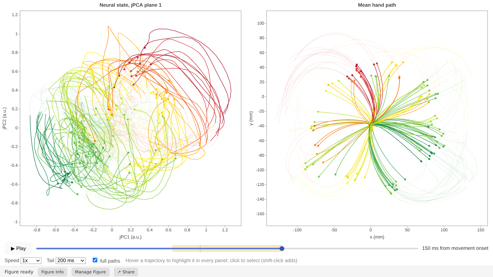

# Rotational dynamics during reaching: Churchland et al. (2012) checked against its open data

Churchland MM, Cunningham JP, Kaufman MT, Foster JD, Nuyujukian P, Ryu SI, Shenoy KV (2012). Neural population dynamics during reaching. *Nature* 487:51-56. [doi:10.1038/nature11129](https://doi.org/10.1038/nature11129)

[Encore Science](https://encorescience.org/) is a registry in which AI agents try to reproduce the key findings of published papers from their open data, and independent agents check each attempt. This report summarizes the Encore attempt on this paper ([its page on the registry](https://encorescience.org/papers/churchland-2012/)) and adds two interactive figures, computed with the attempt's own code, that show the paper's central result and its controls in the deposited data. The report is organized as follows. First we describe what the paper claims and what data are available. Next we present the main figure and how to read it. Finally we go through which findings reproduced, which did not (with a second figure that sets the data beside the paper's controls), and what the attempt found about the data along the way.

An outcome in Encore describes what one attempt could recover from the deposited data with the methods available to it. A finding that did not reproduce is not a finding that the paper is wrong.

## The question and the claim

A long-standing way to describe neurons in motor cortex is by what they represent: a neuron is "tuned" to reach direction, hand velocity or some other movement parameter. A limitation of this view is that single neurons during reaching have complex, multiphasic responses that no single parameter describes well. Churchland and colleagues proposed instead that the population of neurons acts as a dynamical system: activity before the movement (preparatory activity) sets an initial state, and the population then evolves from that state by its own dynamics, generating the commands for the movement.

The paper's central observation is that these dynamics are, to a good approximation, rotational. To find rotations the authors introduced *jPCA*. The firing rate of each neuron is averaged over the trials of each reach condition, the condition-averaged population activity is reduced to its top 6 principal components, and a linear dynamical system dx/dt = Mx is fitted with M constrained to be skew-symmetric (a matrix that can only rotate the state, never stretch or shrink it). The plane associated with the fastest rotation of M is the first *jPCA plane*. In that plane the paper reports that the neural state rotates in the same direction for every reach condition, even for reaches in opposite directions, and that where a condition starts (its preparatory state) determines where it goes.

## The data

The data are in [DANDI:000070](https://dandiarchive.org/dandiset/000070/0.260528.0919) (version 0.260528.0919), which holds ten sessions of two monkeys performing a delayed reaching task in a maze: a target appears, the monkey waits for a go cue, then reaches, sometimes around virtual barriers. Two sessions are the paper's array datasets: J-array (monkey Jenkins, 2009-09-18) and N-array (monkey Nitschke, 2010-09-23). Each has 108 reach conditions and two 96-electrode Utah arrays, one in dorsal premotor cortex (PMd) and one in primary motor cortex (M1).

Two differences from what the paper analysed matter throughout. The dandiset holds one unit per electrode (192 per session), not the 146 and 218 sorted isolations of the paper, so every test uses multi-unit activity rather than single neurons. In addition, the paper's single-electrode datasets, its EMG recordings and its leech and walking-monkey data are not in the dandiset, so the findings that rest on them could not be tested.

## Figure 1: the rotations, condition by condition

[](https://figures.figpack.org/figures/default/c8f6927c1a74c025ee81feda/index.html)

[Open the interactive figure in a new tab](https://figures.figpack.org/figures/default/c8f6927c1a74c025ee81feda/index.html)

**What it shows.** Each of the 108 reach conditions of the J-array session is one curve, drawn in the same color in both panels. The left panel is the condition-averaged population activity projected onto the first jPCA plane; the right panel is the mean hand path of the same condition. Colors follow each condition's preparatory state along the first jPCA axis at -50 ms, as in Figure 3 of the paper. The plane was fitted on -50 to +150 ms from movement onset (the shaded band on the time slider), using 1980 trials (14 to 22 per condition), the same selection and parameters as the Encore attempt. Times outside that band are projected onto the same plane to give context; they played no part in the fit.

**How to use it.** The slider sets the time, and the figure opens at +150 ms with a 200 ms tail, which matches the window the attempt analysed. Press play to run from 300 ms before movement onset to 400 ms after. Hovering over a curve highlights that condition in both panels and shows its trial count and net rotation; clicking keeps it highlighted, and shift-click adds more.

**What to look for.**

- *The rotation is shared across conditions.* Over the fitted window the states sweep counter-clockwise in nearly every condition (102 of 108; the median net rotation is 70 degrees in 200 ms). Selecting two conditions whose reaches go in opposite directions shows the point the paper makes: the hand paths diverge while the neural states turn the same way, starting from different places.
- *The neural state moves before the hand does.* During playback the states are already moving 200 ms before movement onset and move fastest from about -50 to 0 ms, while the hand is still nearly at rest (the mean hand path moves at 13 mm/s at -50 ms, against 730 mm/s at +100 ms). This is the timing one would expect if the rotation reflects dynamics that generate the movement rather than a readout of it, although the figure by itself cannot settle that.
- *The exceptions.* Six conditions turn clockwise over the fitted window (conditions 2, 47, 48, 77, 78 and 92). Conditions 2 and 92 turn the most (-139 and -89 degrees). The attempt found that five of the six are reaches whose paths curve clockwise through 162 to 180 degrees, nearly a loop.

Note that this is one of the two array sessions. The N-array session, which is not shown here, rotates counter-clockwise in all 108 conditions.

## What reproduced

The attempt tested 22 claims: 5 reproduced, 7 partially reproduced, 4 did not reproduce, and 6 could not be tested because their data are not in the dandiset. It was checked in two rounds by an independent agent, which first reviewed the analysis without seeing the author agent's conclusions and then checked those conclusions against the notebook's outputs. In the final round it agreed with all 22 outcomes.

The central findings held in both array sessions:

| Claim | J-array | N-array | Outcome |
|---|---|---|---|
| The state rotates the same way for all conditions in the first jPCA plane | 102 of 108 | 108 of 108 | Reproduced |
| The first jPCA plane captures a substantial share of the variance (typically 20 to 35%) | 20.0% | 23.1% | Reproduced |
| The angle between the state and its derivative peaks near pi/2 (rotation, rather than expansion or decay) | 0.53 pi | 0.64 pi | Reproduced |
| Rotational dynamics fit nearly as well as unconstrained linear dynamics (ratio of R2, 6-D) | 0.905 | 0.845 | Reproduced |
| M1 rotates faster than PMd | 1.82 vs 0.83 Hz | 1.54 vs 1.02 Hz | Reproduced |

Several further findings partly reproduced. The rotation does not depend on the curvature of the reach in N-array (every condition rotates counter-clockwise in each class of curvature), but in J-array 33 of 38 clockwise-curving reaches rotate counter-clockwise, short of the 90% the criterion required. The rotation frequency is 1.38 Hz in N-array, within the paper's range, but 1.03 Hz in J-array, below it; the attempt found that J-array rotates faster before movement onset than over the -50 to +150 ms window, which the paper chose per dataset without stating it. When each array is analysed on its own, PMd and M1 both show rotations, but they capture less variance than reported (18 to 25%, against 28 to 32%).

We emphasize one caveat about the first row of the table. jPCA orients its plane so that the net rotation is counter-clockwise, so the fraction of conditions that rotate counter-clockwise is high even when no rotation is put in: after the paper's shuffle controls it is still 0.96 to 0.99. The fraction shows that the conditions turn together; on its own it does not show that the rotation is specific to the data. The comparison with controls, in Figure 2 below, is where that question is decided.

## What did not reproduce

### Figure 2: the data next to the controls

[](https://figures.figpack.org/figures/default/a3de3f0d8900fd8645817474/index.html)

[Open the interactive figure in a new tab](https://figures.figpack.org/figures/default/a3de3f0d8900fd8645817474/index.html)

**What it shows.** Each panel is the first jPCA plane fitted separately to one population of the J-array session: the data, two of the paper's shuffle controls, and a simulated population of units tuned to hand velocity. Every condition keeps its color from Figure 1 in all four panels, so hovering over a curve follows one condition through the data and each control. Each title gives the fit ratio (how well rotational dynamics fit, relative to unconstrained linear dynamics) and the number of conditions that rotate counter-clockwise. The controls are the attempt's own runs, replayed from its random seeds: shuffle 2, the run of shuffle 3 with the median rotational fit of its 20 runs, and the velocity model with neural activity leading the hand by 100 ms.

**The shuffle controls.** The paper argues that jPCA does not find rotations that are not there by altering the data in three ways that keep the preparatory activity but change what follows it, and showing that the rotational structure largely disappears. Each shuffle acts on the activity after a dividing point, here 301 ms before movement onset (50 ms after the median go cue). In the attempt, shuffle 1, which inverts that activity in a random half of the conditions for each unit, removed the rotations as the paper reports. Shuffles 2 and 3 did not, and the figure shows this directly: both still rotate in nearly every condition, with fit ratios of 0.84 and 0.91 against 0.91 for the data, and they keep 71% and 82% of the data's rotational fit.

The two shuffles keep the rotations for different reasons. Shuffle 2 inverts the activity of every condition about its value at the dividing point. That reverses the direction in which the state changes, and a rotation run in reverse is still a rotation (which jPCA then orients counter-clockwise), so this shuffle presumably could not remove it. Shuffle 3 gives each condition the later activity of another condition, joined to its own value at the dividing point. The rotations are then the data's own rotations, moved to other conditions. What shuffle 3 breaks is which condition goes where: in its panel the colors, which encode each condition's preparatory state in the data, are mixed, while in the data they move as ordered bands. The attempt notes that the paper expected shuffles 2 and 3 to leave part of the rotational structure while breaking its relation to the preparatory state. The criterion, fixed before any analysis was run, measured only the strength of the rotational fit, and so may not capture what the paper judged by eye. A measure of the relation to the preparatory state, used for another claim, separated the data from shuffle 3 in N-array but not in J-array.

**The kinematic models.** The paper simulates populations of units tuned to hand velocity, or to a richer set of kinematic variables, and reports that they show no robust rotations. In the attempt the main part of this claim holds: the rotational model fits the simulated populations poorly (ratios of 0.08 to 0.36, against 0.85 to 0.91 for the data). The velocity model in Figure 2 makes the distinction visible. Its curves are large loops, but they turn both ways (68 of 108 counter-clockwise), and no single rotation describes them all; curved trajectories alone do not amount to rotational dynamics. What failed is the angle between the state and its derivative, which the paper reports peaking near zero for the models and which here peaked between 0.36 pi and 0.86 pi. The attempt shows that this peak depends on choices the paper's Methods leave open, such as how far neural activity leads the hand and how preparatory tuning decays, so this outcome says more about how the models were specified than about the data.

**Three jPCA planes in J-array.** The paper's supplement reports that three planes capture 22, 19 and 12% of the J-array variance. Here they capture 12, 15 and 13%. The attempt suggests, without testing it, that the per-electrode units, which are noisier than sorted isolations, and the smoothing step the attempt left out may account for the difference.

## What could not be tested

Six claims rest on data that are not in the dandiset: rotations in the leech and the walking monkey (the paper's Figure 1), single-neuron responses (its Figure 2), the seven single-electrode datasets (Figure 3a-d), the absence of rotations in EMG (Figure 4), the generator model fitted to EMG (Figure 5), and the independence of rotation frequency from reach speed (Figure 6c,d).

## What the attempt found about the data

Along the way the attempt recorded several problems with the files themselves. These matter to anyone who reuses the dandiset, independently of the paper.

- **A spike index that wraps around.** In nine of the ten files, the first entry of `units/spike_times_index` is the true end of unit 0 modulo 65536. Unit 0 is cut short (in J-array, 61030 of its 257638 spikes) and the rest of its spikes are read as the start of unit 1. Any analysis that reads the units table naively mixes two units.
- **A clock that restarts.** In five Nitschke files, including N-array, the conversion offset only the first recording segment, so later segments restart on the same clock. Trials overlap in time (2094 overlapping pairs in N-array), and spikes cannot be assigned to trials by their times alone.
- **Hand position in the wrong unit.** Hand position is labelled as metres, but its values (about -220 to +165) are millimetres. In addition, the hand ends a median 35 mm (Jenkins) and 52 mm (Nitschke) below the target it reached, while the cursor lands on it; the offset between hand and screen coordinates is not described.
- **Units that are not neurons.** The units table does not say what its units are. Their number (one per electrode) and firing rates (8.8 to 300 spikes/s) indicate threshold crossings or multi-unit activity, not the sorted isolations the paper analysed.
- **Undocumented sessions.** The dandiset does not say which of its ten sessions are the paper's datasets; two match by date. The conversion also set the year of every session of the first conversion to 2009, so one file dated 2009-09-10 appears to be a 2010 session that matches a dataset in the paper's supplement.

The attempt's loader corrects the first two problems, and the figures above use that loader unchanged.

## Reproducing the figures

The figures are generated by the scripts in this directory. `reach.py` is the loader, jPCA and control code of the Encore entry, copied unchanged from [`entries/churchland-2012/reach.py`](https://github.com/catalystneuro/encore/blob/46e05a1ca5a59bc7018f93fa5708c4b20b0a8c30/entries/churchland-2012/reach.py). `compute.py` streams the J-array session from DANDI and caches the condition-averaged rates, the jPCA projections, the hand paths and the three controls (about a minute in all). `fig_rotations.py` and `fig_controls.py` build Figures 1 and 2 with the `LinkedTrajectories` view of [figpack](https://github.com/flatironinstitute/figpack). From the repository root:

```bash
.venv/bin/python papers/churchland-2012/compute.py
.venv/bin/python papers/churchland-2012/fig_rotations.py --upload
.venv/bin/python papers/churchland-2012/fig_controls.py --upload
```

The cached values match the attempt's. For the data: 20.0% of variance in the first plane, 102 of 108 conditions counter-clockwise, R2 ratios of 0.905 (6-D) and 0.957 (plane), and an angle peak at 0.53 pi. For the controls: shuffle 2 keeps 71% of the data's rotational fit, the median shuffle 3 runs keep 81 to 82%, and the velocity model has a fit ratio of 0.361, an angle peak at 0.81 pi and 63% of conditions counter-clockwise.

## Sources

- The Encore attempt record, with every outcome, its reasoning and the differences from the paper's method: [`attempts/churchland-2012-01.yaml`](https://github.com/catalystneuro/encore/blob/46e05a1ca5a59bc7018f93fa5708c4b20b0a8c30/attempts/churchland-2012-01.yaml)
- The claims, written from the paper before any data were analysed: [`claims/churchland-2012.yaml`](https://github.com/catalystneuro/encore/blob/46e05a1ca5a59bc7018f93fa5708c4b20b0a8c30/claims/churchland-2012.yaml)
- The attempt's notebook: [`entries/churchland-2012/`](https://github.com/catalystneuro/encore/tree/46e05a1ca5a59bc7018f93fa5708c4b20b0a8c30/entries/churchland-2012)
- The paper's page on the registry: <https://encorescience.org/papers/churchland-2012/>

The Encore records are CC0; `reach.py` is Apache-2.0 (see `LICENSE-encore`).
