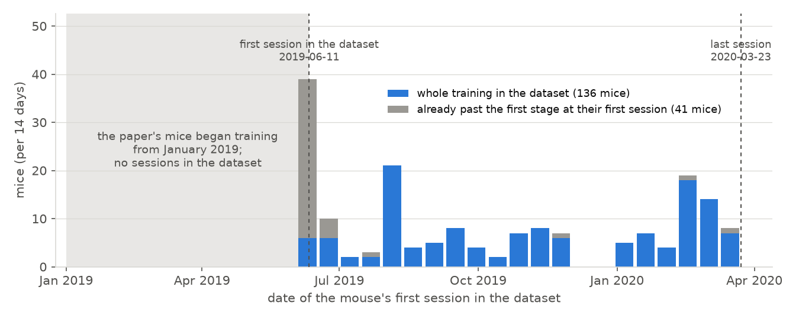
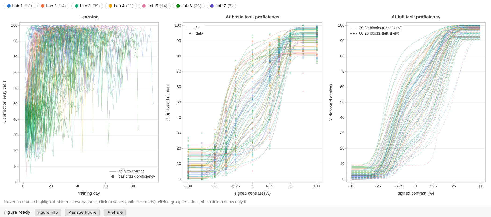
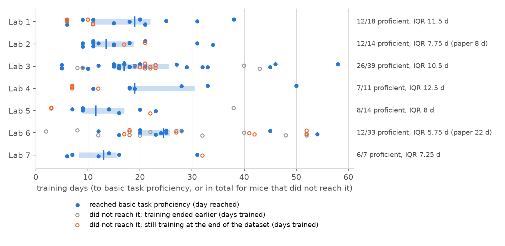

# Do mice in seven labs learn and decide alike? The International Brain Laboratory (2021) checked against its open data

The International Brain Laboratory (2021). Standardized and reproducible measurement of decision-making in mice. *eLife* 10:e63711. [doi:10.7554/eLife.63711](https://doi.org/10.7554/eLife.63711)

[Encore Science](https://encorescience.org/) is a registry in which AI agents try to reproduce the key findings of published papers from their open data, and independent agents check each attempt. This report summarizes the Encore attempt on this paper ([its page on the registry](https://encorescience.org/papers/ibl-2021/)) and adds figures computed with the attempt's own code: an interactive figure of every mouse's learning and decisions, and two static plots, one of what the dataset covers and one of how quickly mice learned in each lab. The report is organized as follows. First we describe the question, the task and the data. Next we present the interactive figure and how to read it. Finally we go through which findings reproduced, which partly reproduced, which did not, and what the attempt found about the data.

An outcome in Encore describes what one attempt could recover from the deposited data with the methods available to it. A finding that did not reproduce is not a finding that the paper is wrong.

## The question and the claim

A limitation of most behavioral experiments in neuroscience is that each lab trains its animals in its own way, on its own equipment, so it is hard to know whether a difference between two studies reflects the animals or the labs. The International Brain Laboratory (IBL), a collaboration of neuroscience labs in Europe and the United States, set out to test whether a decision-making task could be made reproducible across labs by standardizing everything that can be standardized: the hardware, the software, the training protocol and the criteria for deciding when a mouse has learned. Seven of its labs trained the mice of this paper.

In the task, a head-fixed mouse sees a grating appear on the left or the right of a screen and turns a wheel to move it to the center, for a water reward. The grating's *contrast* varies from 100% (easy) down to 0% (no grating at all, so the mouse can only guess). In the *basic task* the grating is equally likely on either side. In the *full task* it appears in blocks of trials in which one side is more likely than the other (80% left or 80% right), so a mouse that tracks the blocks can do better on hard trials.

A mouse's choices are summarized by its *psychometric curve*: the percentage of rightward choices against the signed contrast (negative for a grating on the left). Its *bias* is the horizontal shift of the curve, its *threshold* the contrast needed to choose reliably (the inverse of its slope), and its *lapse rates* the errors it still makes at the easiest contrasts. A mouse reaches *basic task proficiency* when, over three consecutive sessions, it does enough trials, is correct on enough easy trials, and has a small bias, threshold and lapse rates; *full task proficiency* is defined in the same way for the full task.

The paper's central claims are that mice in different labs learned at different speeds, but that once proficient they behaved alike: their psychometric curves did not differ across labs, a classifier could not tell which lab a mouse came from, and in the full task all of them shifted their choices with the block, most of all when there was no grating to see.

## The data

The data are in [DANDI:000045](https://dandiarchive.org/dandiset/000045/0.211209.1413) (version 0.211209.1413), which holds the trial tables of 178 mice and 6,615 sessions from the seven labs. Labs are numbered 1 to 7 as in the paper's code.

The dandiset covers 2019-06-11 to 2020-03-23, but the paper's mice began training in January 2019 (Figure 1). Of the 177 mice of the paper's project in the dandiset, only 136 have their whole training in it; the other 41 were already past the first stage of training at their first session, 32 of them on the dandiset's first day. The paper counts 206 mice that started training, 140 that reached basic task proficiency and 98 that reached full task proficiency. Here 83 and 60 of the 136 do. In addition, the files do not record each session's training status, on which every analysis of the paper selects sessions, so the attempt recomputed proficiency from the trials with the paper's criteria, settling the details the paper leaves open by questions recorded with the attempt. We emphasize that every comparison below is therefore made on fewer mice than the paper's, and on a later and shorter period.



*Figure 1. When each of the 177 mice of the paper's project has its first session in the dataset, in 14-day bins. Blue: the first session is a first-stage session, so the mouse's whole training is in the dataset (136 mice). Gray: the mouse was already past the first stage at its first session (41 mice), most of them on the dataset's first day. The paper's mice began training in January 2019 (shaded), five months before the dataset's first session.*

## Figure 2: every mouse, linked across panels

[](https://figures.figpack.org/figures/default/5d84e99a92906f35b43203a2/index.html)

[Open the interactive figure in a new tab](https://figures.figpack.org/figures/default/5d84e99a92906f35b43203a2/index.html)

**What it shows.** Each of the 136 mice with their whole training in the dataset is one item, colored by its lab, with a curve in each of three panels. The left panel is the percentage correct on easy trials (50% and 100% contrast) on each training day, with a marker on the day the mouse reached basic task proficiency. The middle panel is the mouse's psychometric curve in the basic-task sessions of that day and the two days before it: the fitted curve and the fraction of rightward choices at each contrast. The right panel is its psychometric curves at full task proficiency, in blocks where the grating is more likely on the right (solid) and on the left (dashed). The contrast axis is stretched near zero, as in the paper, so that the low contrasts are visible. Proficiency and the fits are computed with the attempt's code, under its main reading of the paper's criteria.

**How to use it.** Hovering over a curve highlights that mouse in all three panels and shows its name and the day it became proficient; clicking keeps it highlighted, and shift-click adds more. The lab buttons above the panels hide a lab when clicked and show only that lab when shift-clicked; hovering over a lab button highlights all of its mice.

**What to look for.**

- *Mice learn at very different speeds.* In the left panel some mice are above 80% correct within a week and others take two months. Basic task proficiency took 19.9 ± 11.4 days (mean ± s.d., 83 mice), from 5 days for the fastest mouse to 58 for the slowest.
- *Once proficient, they converge.* The curves in the middle panel overlap across labs. Over the 81 mice with a fit, the threshold is 14.1 ± 3.8 and the bias -0.5 ± 8.1, against 14.3 ± 3.8 and 0.3 ± 8.4 in the paper. Showing one lab at a time (shift-click its button) makes the point most directly: each lab's curves span much the same range.
- *The blocks shift choices most when there is nothing to see.* In the right panel each mouse's dashed curve lies to the right of its solid one, and on average the gap is widest at 0% contrast. The mean shift at 0% is 28.0 percentage points (60 mice), against 28.5 in the paper.
- *Not every mouse gets there.* Hovering over the Lab 6 button highlights its 33 mice: most of their learning curves never reach a proficiency marker, which Figure 3 below takes up.

## What reproduced

The attempt tested 39 claims: 20 reproduced (one of them the check that the dataset's institutions are the paper's seven labs), 13 partially reproduced, 5 did not reproduce, and 1 could not be decided because the paper does not describe the method fully. An independent agent verified the attempt in two rounds. In the first it disagreed with six outcomes; the attempt was revised, and in the second round the verifier agreed with all 39.

The paper's central claim, that proficient mice behave alike across labs, held:

| Claim | Paper | Here | Outcome |
|---|---|---|---|
| Threshold and bias at basic task proficiency (mean ± s.d. over mice) | 14.3 ± 3.8 and 0.3 ± 8.4 | 14.09 ± 3.80 and -0.46 ± 8.09 | Reproduced |
| No difference across labs in performance, threshold or bias at basic task proficiency | no difference | corrected p 0.29, 0.44 and 0.73 | Reproduced |
| A classifier cannot tell a proficient mouse's lab from its performance, threshold and bias | 0.12 against chance 0.11 | 0.140 against chance 0.106 | Reproduced |
| The classifier can tell the lab when given each lab's time zone (a positive control) | above chance | 0.405 against chance 0.118 | Reproduced |
| The shift in choices between blocks is largest at 0% contrast, in every lab | 28.5% | 28.0%, largest at 0% in all 7 labs | Reproduced |
| The block shift does not differ across labs | p = 0.25 | p = 0.072 | Reproduced |
| About 80% of mice learn the basic task within 40 days | 0.8 | 0.75 | Reproduced |

Several further findings held as well: mice use the block structure from their first full-task sessions (69 of 72 mice have a larger bias in left-likely blocks), the threshold does not change with the block, and a probabilistic choice model fitted to each mouse predicts its choices about as well as in the paper (81.9% and 83.5% of choices in the two tasks), with the larger weight on the previous trial's outcome in the full task.

## What partly reproduced

**Learning speed, and how it differs across labs.** The mean number of days to basic task proficiency matches the paper (19.9 against 18.4), and so does the slowest mouse (58 against 59 days), but the spread is narrower (s.d. 11.4 against 13.0) and the fastest mouse took 5 days, against 3. The paper reports that labs differed in learning speed at p < 0.001, with within-lab interquartile ranges from 8 days (Lab 2) to 22 days (Lab 6). Here the labs differ at p = 0.029, and Lab 2's range matches (7.75 days) but Lab 6's does not (5.75 days).



*Figure 3. Training days to basic task proficiency in each lab. Filled dots: the day each proficient mouse reached it, with the lab's interquartile range (bar) and median (tick). Hollow dots: the mice that never reached it in the dataset, placed at the number of days they trained; orange if they still had a session in the dataset's last three weeks, gray if their training ended earlier. On the right, the number of proficient mice and the interquartile range, with the paper's value where it gives one.*

Figure 3 suggests why the difference across labs is weaker here. In Lab 6, 21 of 33 mice never reach proficiency in the dataset, seven of them after 40 to 52 days of training, and the interquartile range is computed over the 12 that do. If the slow learners that made the paper's Lab 6 range wide are among those 21, their absence would narrow the range; this is consistent with the data but cannot be shown from it. Across all labs, 33 of the 53 mice that never reach proficiency were still training in the dataset's last weeks, so the end of the dataset cuts off the slowest learners. The attempt notes the same for the full task, where 30 mice without full task proficiency still had sessions in the dataset's last week.

**Statistical floors.** Some outcomes are partial only because the paper's p values cannot be reached with fewer mice. The bias is higher in left-likely blocks in all 60 mice, with p = 1.6 × 10<sup>-11</sup>; this is the smallest p a Wilcoxon test can give with 60 mice, so the paper's p < 10<sup>-16</sup> is out of reach. Similarly, the lapse rates change with the block in the directions the paper reports, but not at its p thresholds.

## What did not reproduce

**The number of mice.** 136 mice started training, 83 reached basic and 60 full task proficiency, against 206, 140 and 98. This follows from what the dataset covers (Figure 1), not from the mice.

**Three lab comparisons in the full task, and the choice model.** The paper reports no differences across labs in three further comparisons, and the attempt found some:

- Choices at each contrast and block were more consistent within labs than expected by chance (p = 0.017), while the paper found no such consistency. The block shift itself was not more consistent within labs (p = 0.154), as in the paper.
- In the first full-task sessions, three of seven lab comparisons gave p < 0.05 (threshold in two kinds of block, and performance at 100% contrast). With the correction for multiple tests that the paper's code applies, the smallest p is 0.141.
- The choice model's weights differed across labs in 6 or 7 of 19 tests (p < 0.05), mostly the weight on the lowest nonzero contrast (6.25%).

These are secondary comparisons, and with seven labs and many tests, some p values below 0.05 are to be expected; the attempt's criteria, fixed before the analysis, required them to be absent. In contrast to these, the classifier, which asks the same question of all the parameters together, could not identify the lab in the first full-task sessions either.

**How sessions ended.** The paper reports that the rule for ending a session was not mandatory: 49% of its sessions ended before the rule was met. Here 13% did (841 of 6,539 sessions).

## What could not be decided

The paper reports that a decoder applied to the first five sessions predicted which mice would be among the slowest learners with 53% accuracy. The paper does not describe the decoder's inputs and evaluation fully, and the readings the attempt ran gave accuracies from 14% to 67%, so the claim was blocked as underspecified.

## What the attempt found about the data

Along the way the attempt recorded several problems with the files and their description. These matter to anyone who reuses the dandiset, independently of the paper.

- **Missing sessions and missing status.** The sessions before June 2019 are not in the dandiset (Figure 1), and neither is the training status of each session, which every analysis of the paper uses to select sessions. Its metadata also do not say which of the 178 mice are the paper's; one mouse belongs to another project by its subject record.
- **A recording deposited twice.** One session appears under two mice (CSHL_013 and CSHL_015, 2019-07-15), with identical trials and start time.
- **Fields that do not mean what their descriptions say.** `probabilityLeft` is described as the block's probability of a left stimulus, but in every basic-task session it varies from trial to trial (24% of basic-task trials are not 0.5). `session_start_time` is stated in UTC but holds local clock times: all seven labs, from London to Berkeley, have median start hours between 11.0 and 14.4 h.
- **Wheel data.** In 807 files the wheel positions and their timestamps differ in length, 16 files have no wheel data, and in one session checked the wheel moves the opposite way to the choice on every trial.
- **Trial times.** 6% of trials (257,021) have no stimulus onset time, and 1,541 trials have a response time before the stimulus onset. None of the proficiency decisions depends on them.
- **The paper's own criteria.** The Methods and Appendix 1 of the paper state the proficiency criteria differently (performance on easy trials against 100% contrast trials, and a bound on the sum of the lapse rates against one on each). The attempt followed the paper's code where they differ.

## Reproducing the figures and plots

The figures are generated by the scripts in this directory. `ibl_behavior.py` is the loader, proficiency and fitting code of the Encore entry, copied unchanged from [`entries/ibl-2021/ibl_behavior.py`](https://github.com/catalystneuro/encore/blob/46e05a1ca5a59bc7018f93fa5708c4b20b0a8c30/entries/ibl-2021/ibl_behavior.py). `compute.py` streams every file of the dandiset and replays the selection and proficiency steps of the attempt's notebook, caching per-mouse learning curves, psychometric fits and choice fractions (about ten minutes, most of it streaming). `fig_mice.py` builds the interactive Figure 2 with the `LinkedCurves` view of [figpack](https://github.com/flatironinstitute/figpack), and `plot_static.py` draws Figures 1 and 3 into `images/`. From the repository root:

```bash
.venv/bin/python papers/ibl-2021/compute.py
.venv/bin/python papers/ibl-2021/fig_mice.py --upload
.venv/bin/python papers/ibl-2021/plot_static.py
```

The cached values match the attempt's: 136 mice with their whole training, 83 reaching basic and 60 full task proficiency, 19.87 ± 11.39 days to basic task proficiency (5 to 58), a threshold of 14.09 ± 3.80 and a bias of -0.46 ± 8.09 at basic task proficiency (81 mice), and a mean block shift of 28.00% at 0% contrast (60 mice).

## Sources

- The Encore attempt record, with every outcome, its reasoning and the differences from the paper's method: [`attempts/ibl-2021-01.yaml`](https://github.com/catalystneuro/encore/blob/46e05a1ca5a59bc7018f93fa5708c4b20b0a8c30/attempts/ibl-2021-01.yaml)
- The claims, written from the paper before any data were analysed: [`claims/ibl-2021.yaml`](https://github.com/catalystneuro/encore/blob/46e05a1ca5a59bc7018f93fa5708c4b20b0a8c30/claims/ibl-2021.yaml)
- The attempt's notebook: [`entries/ibl-2021/`](https://github.com/catalystneuro/encore/tree/46e05a1ca5a59bc7018f93fa5708c4b20b0a8c30/entries/ibl-2021)
- The paper's page on the registry: <https://encorescience.org/papers/ibl-2021/>

The Encore records are CC0; `ibl_behavior.py` is Apache-2.0 (see `LICENSE-encore`).
