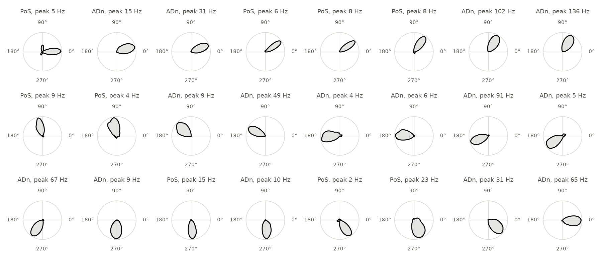
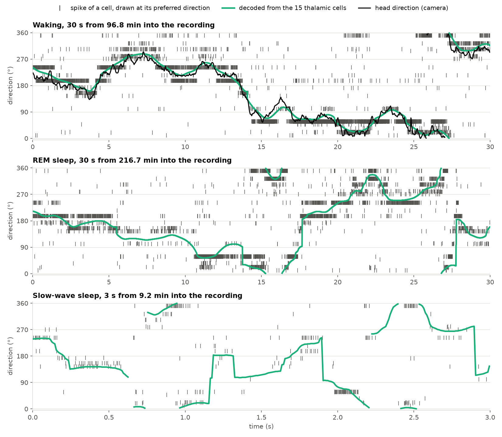
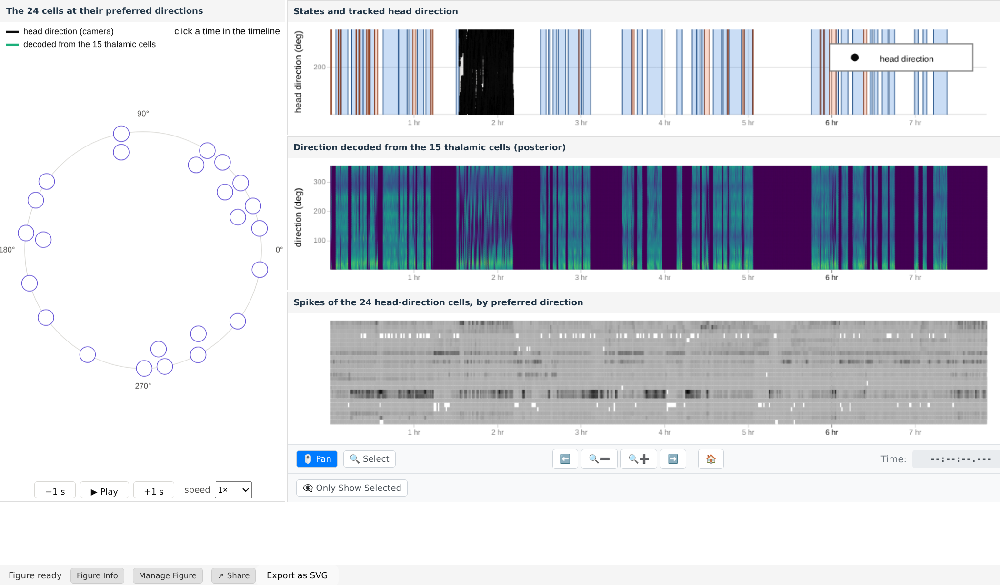
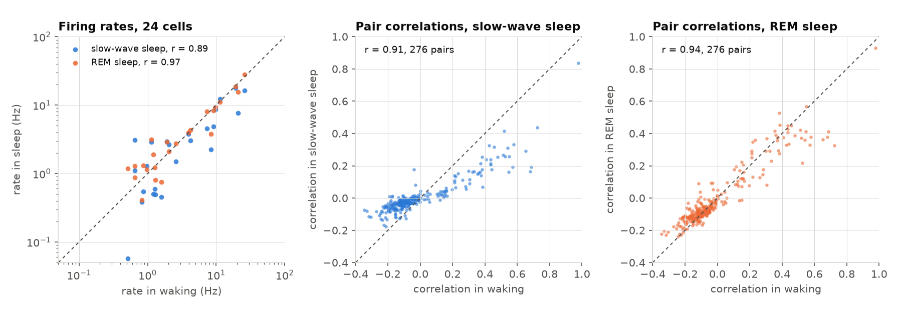
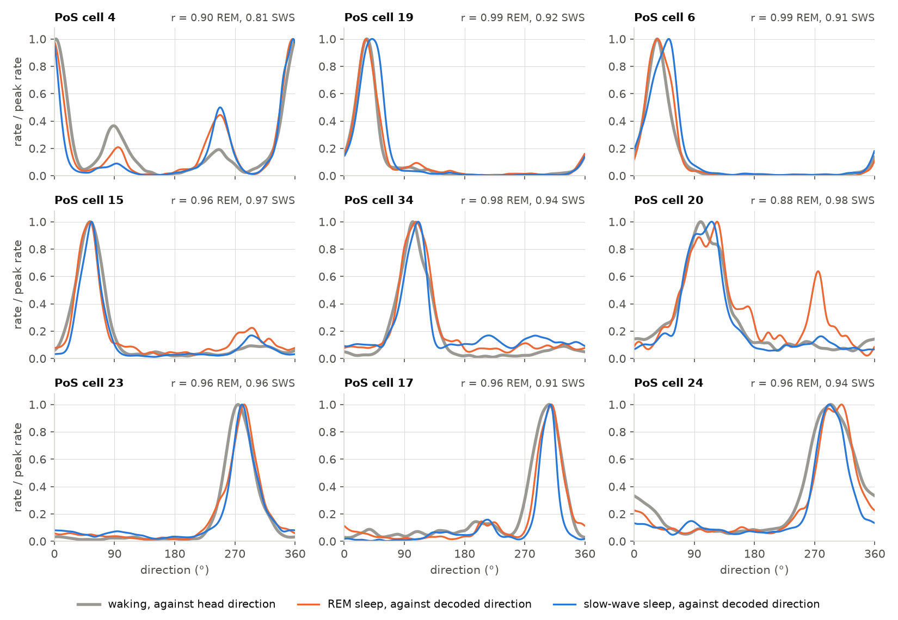

# The brain's compass keeps turning during sleep: Peyrache et al. (2015) checked against its open data

Peyrache A, Lacroix MM, Petersen PC, Buzsáki G (2015). Internally organized mechanisms of the head direction sense. *Nature Neuroscience* 18:569-575. [doi:10.1038/nn.3968](https://doi.org/10.1038/nn.3968)

[Encore Science](https://encorescience.org/) is a registry in which AI agents try to reproduce the key findings of published papers from their open data, and independent agents check each attempt. Its attempt on this paper ([the paper's page on the registry](https://encorescience.org/papers/peyrache-2015/)) tested 35 claims and reproduced 22 of them. This report explains the main finding that held up, for a reader who has not worked on the brain's sense of direction, and shows it in the data. All figures are computed from one recording session with the attempt's own code; the population-level numbers are the attempt's, over all sessions.

The report is organized as follows. First we describe head-direction cells and the question the paper asks about them. Next we show how the direction an animal is facing can be read from these cells, and what the same reading shows during sleep. Then we present the two lines of evidence that the activity in sleep is organized as in waking. Finally we note briefly what did not reproduce.

## Head-direction cells

Many animals keep track of which way they are facing, even in the dark. In mammals this sense relies on *head-direction cells*: neurons that fire when the head points in one particular direction in the horizontal plane, whatever the animal's position, and are nearly silent otherwise. The direction at which a cell fires most is its *preferred direction*, and the curve of its firing rate against head direction is its *tuning curve*. Different cells prefer different directions, so that together they cover the whole circle, much like the needle positions of a compass.



*The tuning curves of the 24 head-direction cells recorded in one session (mouse 28, 2014-03-13), measured while the mouse explored an open arena, in order of preferred direction. Each curve is the cell's firing rate in each direction of the head, scaled to its peak; the peak rate is given above it. ADn: anterodorsal thalamus; PoS: post-subiculum.*

Head-direction cells are found in several connected brain regions. This paper recorded from two of them at once, with silicon probes in mice: the *anterodorsal nucleus of the thalamus* (ADn) and the *post-subiculum* (PoS), a region of the cortex next to the hippocampus that receives input from the ADn. A cell is counted as a head-direction cell when its tuning curve has a single clear peak (by the paper's criteria, a fitted von Mises concentration above 1, a peak rate above 1 Hz and a Rayleigh test p below 0.001).

## The question

A head-direction cell could fire because of what the animal senses: the view of familiar landmarks, the signals from the inner ear as the head turns. Or the cells could form a network that holds a direction by itself, with the senses only correcting it. In the second case, the cells should keep their relationships when the senses play no role. The paper tests this in sleep, when the head is still and the eyes are closed. If the network generates the direction internally, the population activity during sleep should still look like a single direction, a *bump* of activity among the cells whose preferred directions are close together, and the bump should move as it does in waking.

## The data

The recordings are in [DANDI:000056](https://dandiarchive.org/dandiset/000056/0.261106.1949) (version 0.261106.1949): 42 sessions from 7 mice, each with the spike times of the sorted units, the region of each unit, the head direction tracked by a camera from two LEDs on the head, and, in most sessions, the lab's scoring of sleep into slow-wave and REM sleep. In each session the mouse explored an open arena for about half an hour and slept in its home cage for several hours before and after.

The figures here use the session of mouse 28 recorded on 2014-03-13, which has the most ADn head-direction cells of the sessions with both regions: 15 in the ADn and 9 in the PoS. It has 38 minutes of waking in the arena, 3.1 hours of slow-wave sleep and 23 minutes of REM sleep.

## Reading the direction from the cells

If each cell fires mostly at its own preferred direction, then the pattern of firing across the cells tells which direction the head is pointing. A *decoder* turns that pattern into a direction. The paper uses a Bayesian decoder: for each 10 ms of recording it asks which direction would make the observed spike counts most likely, given each cell's waking tuning curve. Its output is a direction for every moment, computed from spikes alone.



*Spikes of the 24 head-direction cells, each drawn at the height of the cell's preferred direction, with the direction decoded from the 15 ADn cells (aqua) and, in waking, the head direction tracked by the camera (black). Top: 30 s of waking. Middle: 30 s of REM sleep. Bottom: 3 s of slow-wave sleep; note the shorter time scale. Each window is the one, within its state, in which the decoded or tracked direction covered the widest range of directions.*

The top panel shows waking. At any moment the spikes come mostly from a few cells with neighbouring preferred directions, so that they form a band, and the band moves with the head: when the mouse turns from about 220° to 70° between 13 and 15 s, the active cells change in the same way. The decoded direction follows the tracked head closely. Over this session the median difference between the two is 10.1°, and over all 25 ADn ensembles of the dataset the attempt finds a median error of 10.2° (and 14.4° for the 5 PoS ensembles), against 76 to 77° when the head direction is shifted by 10 s as a control. This reproduces the paper's statement that the decoded signal faithfully tracks the head direction of the waking mouse.

The middle panel shows REM sleep. The mouse is asleep and its head is still, but the spikes still form a single band, and the band drifts from one direction to the next at a speed similar to that of waking, with occasional jumps. The decoder, which knows nothing about sleep, reads a coherent direction from it. The bottom panel shows slow-wave sleep at a ten times finer time scale. The band is still there, but it moves much faster, and it is interrupted by moments of silence.

These windows are three examples. The interactive figure below shows the whole session, so that any stretch of waking or sleep can be checked in the same way.

## Figure 1: the whole session, interactive

[](https://figures.figpack.org/figures/default/5df05e1093318696ccdc8f42/index.html)

[Open the interactive figure in a new tab](https://figures.figpack.org/figures/default/5df05e1093318696ccdc8f42/index.html)

**What it shows.** The whole 7.9 hour session. On the left, the 24 head-direction cells sit on a ring at their preferred directions, as in the tuning curves above, and each dot flashes when its cell spikes. Two needles point to the head direction tracked by the camera (black, waking only) and to the direction decoded from the 15 ADn cells (aqua). The ring shows a single moment, the current time of the three tracks on the right, which share one time axis:

1. The scored states (waking gray, slow-wave sleep blue, REM sleep orange) and the head direction tracked by the camera. The tracking is shown in waking only; the file holds an LED angle for the whole session, but in the home cage it changes by about 30° per second while the mouse sleeps, presumably from tracking noise, and the attempt also uses waking only.
2. The decoded direction as a *posterior*: for each 50 ms and each 6° of direction, how probable the decoder finds that direction given the spikes of the 15 ADn cells (bright is probable). It is computed in the scored states only, with the attempt's smoothing (300 ms in waking and REM, 50 ms in slow-wave sleep).
3. The spikes of the 24 head-direction cells, one row per cell, in order of preferred direction, labelled with region, unit number and preferred direction.

**How to use it.** Clicking a time in any track sets the current time and shows the ring at that moment. **Play**, below the ring, runs time forward at the chosen speed (1× is real time; 0.1× slows it down tenfold), and the tracks follow; if the tracks show the whole session, Play first zooms them to about 30 s. Zooming or panning in any track moves all three: the magnifier buttons zoom in and out, in "Select" mode dragging across a stretch of time zooms to it, and the house button returns to the whole session. The figure holds about 105 MB, but each track is stored at several resolutions, and the ring stores its spikes in 10 s blocks, so the viewer loads only what the current view needs.

**What to look for.** At the scale of the whole session there is little to see; the result appears at the scale of seconds. Click in the waking period (from 1 h 33 min to 2 h 11 min) and press Play: the flashing cells form a group on one side of the ring that turns with the black needle, and the aqua needle follows it. Then click in a REM episode, for example the one at 3 h 37 min (the middle panel above), and press Play. The black needle is gone, because the head is still and not tracked, but the group of flashing cells and the aqua needle keep turning around the ring, much as in waking. In slow-wave sleep, for example at 9 min, the group jumps around the ring faster, and 0.1× shows its course more clearly. In the tracks, the same activity appears as a bright band in the posterior and as diagonal stripes in the spikes.

## The cells keep their relationships during sleep

If the direction in sleep is generated by the same network as in waking, the cells should keep the relationships they have in waking. The paper tests two of them.



*Left: the mean firing rate of each of the 24 head-direction cells in waking against its rate in slow-wave sleep (blue) and in REM sleep (orange). Middle and right: the correlation of the spike counts of each pair of cells in waking against the same pair's correlation in slow-wave sleep and in REM sleep (276 pairs; counts in 300 ms bins in waking and REM and 50 ms bins in slow-wave sleep, as in the attempt). Dashed lines: equal values. One session.*

First, firing rates. A cell that fires fast in waking also fires fast in sleep (left). Over the dataset, the attempt finds that waking rates correlate with sleep rates at r = 0.80 (slow-wave) and 0.86 (REM) for 274 ADn head-direction cells, and at 0.65 and 0.66 for 69 PoS cells, all significant; this reproduces the paper's claim.

Second, pair correlations. Two cells with nearby preferred directions fire together in waking, because the head points to both of their directions at once; two cells with opposite preferred directions rarely do. In sleep this could only persist if the activity is still organized as a single direction. It does (middle and right): pairs that are positively correlated in waking remain so in sleep, and pairs that are negatively correlated in waking remain negative. Over the dataset, the attempt finds that the waking correlations predict the sleep correlations with r from 0.81 to 0.97 for every type of pair, every reading of the paper's cell criteria and both sleep states (more than 1,000 ADn pairs), which reproduces the paper's claim. The attempt also reproduces the paper's estimate, from the timing of these correlations, that the direction moves at about the same speed in REM sleep as in waking (median ratio of REM to waking speed 0.96 to 1.20).

## Tuning curves measured in sleep

The strongest test uses the two regions together. During sleep there is no head direction to measure a tuning curve against. But the direction decoded from the ADn cells is available, so one can measure a PoS cell's tuning curve against the ADn's decoded direction instead. If the two regions share one internal direction, the curve measured this way in sleep should match the cell's waking tuning curve, measured against the real head direction. The PoS cells play no part in the decoding, so the test is not circular.



*For each of the 9 PoS head-direction cells of the session: its waking tuning curve, measured against the head direction tracked by the camera (gray), and its tuning curve measured against the direction decoded from the 15 ADn cells in REM sleep (orange) and in slow-wave sleep (blue). Each curve is scaled to its peak; r is the correlation between the sleep curve and the waking curve.*

In this session the curves measured in sleep peak at the same directions as the waking curves, with median correlations of 0.96 in REM and 0.94 in slow-wave sleep. Over the dataset, the attempt finds median correlations of 0.92 (REM) and 0.90 (slow-wave) for 51 to 64 PoS cells decoded from the ADn, and 0.87 and 0.81 for 43 to 52 ADn cells decoded from the PoS. This reproduces the paper's claim that tuning curves computed in sleep from the other structure are "remarkably similar" to the waking ones.

The asymmetry in those numbers is itself a reproduced claim. PoS curves decoded from the ADn match better than ADn curves decoded from the PoS, in every state (Mann-Whitney p = 7.0 × 10<sup>-7</sup> in waking, 5.0 × 10<sup>-4</sup> in slow-wave and 0.039 in REM sleep). In the same direction, a model that predicts each cell's spikes from the activity of the other region does better from the ADn to the PoS than the reverse (median 0.67 against 0.55 bits per spike in waking, 0.63 against 0.17 in slow-wave and 0.49 against 0.33 in REM sleep). Both fit the paper's interpretation that the direction signal is organized in the thalamus and passed on to the cortex, rather than the reverse.

Taken together, these results support the paper's conclusion: the head-direction system holds a single, coherent direction that it generates internally, with or without input from the senses, and that keeps moving through sleep.

## Caveats and what did not reproduce

Of the attempt's 35 outcomes, 22 are reproduced, 9 partially reproduced and 4 not reproduced; two rounds of independent verification agreed with 33 and 34 of them, and a third round settled the remaining two. The main limitations are these.

- **The speed in slow-wave sleep.** The direction does move faster in slow-wave sleep than in waking, in about 96% of ADn pairs under one reading of the cell criteria, but the attempt finds a ratio of 11 to 12 in ADn pairs and 5 to 6 in PoS pairs, against the paper's "about tenfold" (partially reproduced). The speed computed directly from the decoded direction depends on how the speed is measured, which the paper does not specify, and gives smaller ratios (partially reproduced).
- **Weaker rate correlations in the PoS.** The PoS rate correlations (0.65 and 0.66) pass the claim's criterion but are lower than the ADn's.
- **A decoder comparison.** The paper reports that a decoder using the correlations between cells is about 50% better in the ADn than one that ignores them. The attempt finds no gain (not reproduced); the paper's Methods do not describe this decoder, so the result rests on the estimator the attempt assumed.
- **Counts.** The fraction of cells classified as head-direction cells, the number of putative monosynaptic connections between the two regions, and a control showing that the regions' difference in pair correlations does not come from their firing rates did not reproduce, and several cell and session counts held only in part. The files do not mark which sessions the paper kept, and no analysis code is linked to the paper.
- **This report's figures** show one session; the dataset-wide numbers are the attempt's.

A failure to reproduce in Encore describes what one attempt could recover from the deposited data with the methods available to it, not a finding that the paper is wrong.

## Reproducing the figures and plots

`hd.py` is the loading and analysis module of the Encore entry, copied unchanged from [`entries/peyrache-2015/hd.py`](https://github.com/catalystneuro/encore/blob/a81ed60ba3e1ddcd77aeb9e69f01c0c29fc91bb3/entries/peyrache-2015/hd.py). `compute.py` streams the session's units, head direction and sleep states (about 30 s), classifies the head-direction cells, computes their tuning curves, decodes the direction in every state with the attempt's decoder, and computes the posterior over the whole session for Figure 1. `fig_session.py` builds Figure 1 from the RingRaster view of `figpack_experimental`, written for this report, and figpack's existing views (TimeseriesGraph, Spectrogram and the spike-sorting RasterPlot), and `plot_static.py` draws the static plots into `images/`. From the repository root:

```bash
.venv/bin/python papers/peyrache-2015/compute.py
.venv/bin/python papers/peyrache-2015/fig_session.py --upload
.venv/bin/python papers/peyrache-2015/plot_static.py
```

## Sources

- The Encore attempt, with every outcome, its reasoning and the differences from the paper's method: [`attempts/peyrache-2015-02.yaml`](https://github.com/catalystneuro/encore/blob/a81ed60ba3e1ddcd77aeb9e69f01c0c29fc91bb3/attempts/peyrache-2015-02.yaml)
- The claims tested: [`claims/peyrache-2015.yaml`](https://github.com/catalystneuro/encore/blob/a81ed60ba3e1ddcd77aeb9e69f01c0c29fc91bb3/claims/peyrache-2015.yaml)
- The attempt's notebooks: [`entries/peyrache-2015/`](https://github.com/catalystneuro/encore/tree/a81ed60ba3e1ddcd77aeb9e69f01c0c29fc91bb3/entries/peyrache-2015)
- The paper's page on the registry: <https://encorescience.org/papers/peyrache-2015/>

The Encore records are CC0; `hd.py` is Apache-2.0 (see `LICENSE-encore`).
