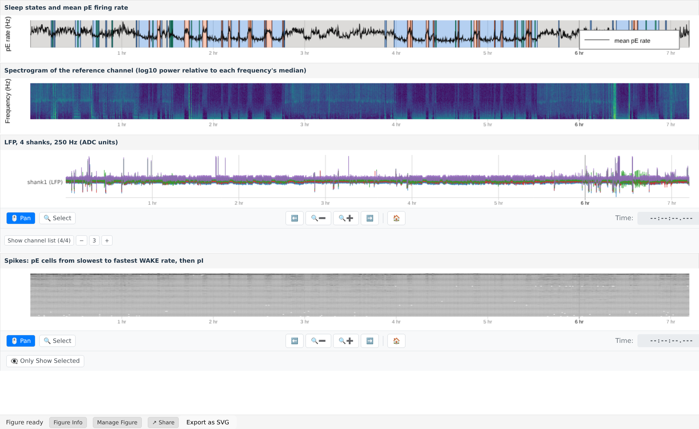
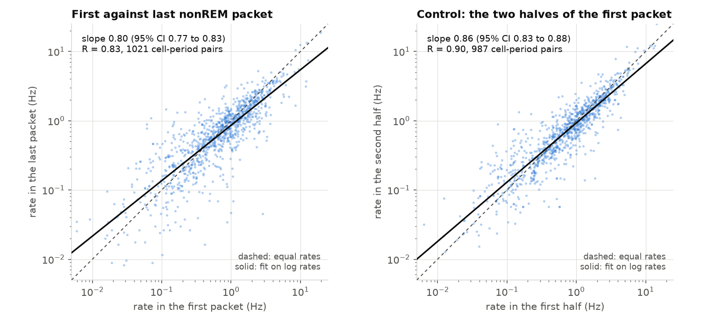
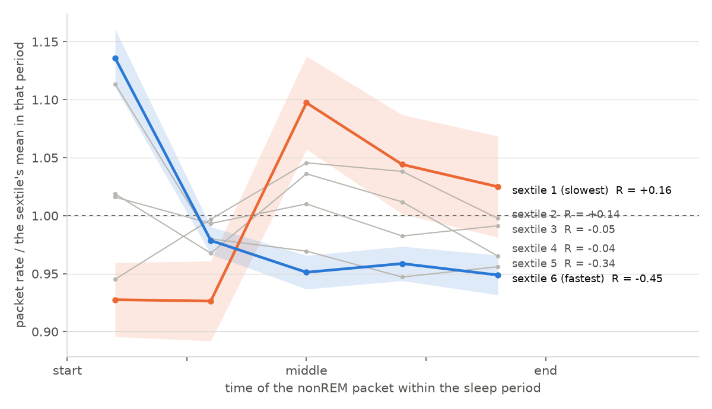

# Does sleep even out cortical firing? Watson et al. (2016) checked against its open data

Watson BO, Levenstein D, Greene JP, Gelinas JN, Buzsáki G (2016). Network homeostasis and state dynamics of neocortical sleep. *Neuron* 90:839-852. [doi:10.1016/j.neuron.2016.03.036](https://doi.org/10.1016/j.neuron.2016.03.036)

[Encore Science](https://encorescience.org/) is a registry in which AI agents try to reproduce the key findings of published papers from their open data, and independent agents check each attempt. This report summarizes the Encore attempts on this paper ([its page on the registry](https://encorescience.org/papers/watson-2016/)) and adds figures computed with the attempts' own code: an interactive figure of one whole night of recording, which can be explored from hours down to fractions of a second, and two static plots of the paper's central result. The report is organized as follows. First we describe the question and the data. Next we present the interactive figure and how to read it. Then we go through the central result, the findings that did and did not reproduce, and what the attempts found about the data. Finally we note how the later attempts, on the paper's complete data set, compare.

An outcome in Encore describes what one attempt could recover from the deposited data with the methods available to it. A finding that did not reproduce is not a finding that the paper is wrong.

## The question and the claim

During waking, the firing rates of cortical neurons differ by orders of magnitude, from cells that fire once every few minutes to cells that fire several times a second, and the distribution is strongly skewed. A long-standing idea is that sleep serves some kind of homeostasis: that it restores something that waking disturbs. Watson and colleagues asked what sleep does to the firing rates of individual neurons, by recording populations of cells in the frontal cortex of rats in their home cage for hours at a time, across natural waking and sleep.

Sleep in these recordings is divided into states. In *nonREM* sleep the cortex alternates between brief periods of population firing (*UP states*) and silence (*DOWN states*), which appear in the local field potential (LFP) as large slow waves; *REM* sleep looks more like waking. The paper calls an uninterrupted stretch of nonREM a *packet*, a waking interruption of less than 40 s between nonREM epochs a *microarousal*, and an alternation of nonREM and REM lasting at least 20 minutes, ended by more than 2 minutes of waking, a *sleep period*.

The paper's central claim is that sleep evens out firing rates. Across a sleep period, the fastest-firing pyramidal cells slow down and the slowest-firing cells speed up, so that the spread of rates narrows; the population rate as a whole declines. The paper also reports that these changes happen within nonREM, that they depend on the slow waves, spindles and microarousals of nonREM, and that REM and waking between packets have their own effects.

## The data

The data are in [DANDI:000041](https://dandiarchive.org/dandiset/000041/0.250624.0419) (version 0.250624.0419), which holds one file per session: the spike times and cell types of the sorted units, the lab's sleep-state scoring at 1 s resolution, and LFP at 1250 Hz from silicon probes in medial prefrontal, orbitofrontal, anterior cingulate and secondary motor cortex. The dandiset holds 22 sessions from 10 rats, against 27 sessions from 11 rats in the paper, and 945 units, against the 995 putative pyramidal cells (pE) and 126 interneurons (pI) the paper analyses. One session's spike times are unusable (see the findings about the data below), leaving 21 sessions with 812 pE and 89 pI cells.

The same experiments are also deposited, as the lab's original files, at [CRCNS (fcx-1)](https://doi.org/10.6080/K02N506Q), with all 27 sessions and the lab's own intervals for microarousals and other sub-states. The first Encore attempt used the dandiset alone, and the figures here use the same version and code. Later attempts used both, as described at the end.

## Figure 1: one night, from hours to milliseconds

[](https://figures.figpack.org/figures/default/730b41191429901255ab76e7/index.html)

[Open the interactive figure in a new tab](https://figures.figpack.org/figures/default/730b41191429901255ab76e7/index.html)

**What it shows.** One whole session of the dandiset: rat Rizzo, recorded on 2015-02-27 for 7.2 hours, with 93 units on an 8-shank probe. Four tracks share one time axis:

1. The sleep states as scored by the lab (waking gray, nonREM blue, REM orange, microarousals green, as defined by the attempt) and the mean firing rate of the pE cells in 10 s bins.
2. The spectrogram of the LFP channel the attempt used as its reference, from 0.5 to 100 Hz. Each frequency is shown relative to its median over the night, so that changes of state are not swamped by the fall of power with frequency.
3. The LFP of four channels at the same depth on every second shank, filtered and downsampled to 250 Hz, which keeps everything below 100 Hz. The values are in the stored ADC units, because the file gives no valid conversion to volts (see below).
4. The spikes of all 93 units: the pE cells ordered from the slowest to the fastest waking rate, then the interneurons.

**How to use it.** Zooming or panning in any track moves all four. The magnifier buttons zoom in and out; in "Select" mode, dragging across a stretch of time zooms to it, and the house button returns to the whole night. The LFP track's channel list shows and hides channels and sets their spacing.

**What to look for.**

- *The night's structure.* At the scale of the whole session, the nonREM periods appear as bright low-frequency bands in the spectrogram, matching the blue intervals of the state track, and the mean pE rate is lower in nonREM than in waking (1.22 Hz against 1.79 Hz in this session). This session has 3.6 hours of waking, 3.0 of nonREM and 0.5 of REM, but only one complete sleep period by the paper's definition (30 minutes, from about 6 h 22 min to 6 h 52 min).
- *UP and DOWN states.* Zooming into a long nonREM packet, for example the one from about 3 h 59 min to 4 h 7 min, down to a few seconds shows the paper's picture of nonREM: large, slow LFP deflections on all four shanks, each coinciding with a brief gap across almost the whole raster, a DOWN state, between bursts of population firing. The attempt could not test the paper's findings about UP and DOWN states, because the criteria used to detect them are given only in the paper's supplement, which it could not retrieve; the figure shows them only by eye.
- *Waking and REM.* A few seconds of waking or REM show no such population-wide silences. In this session 11.6% of 50 ms bins in nonREM contain no spike from any of the 93 units, against 0.5% in waking and 0.07% in REM.

**Loading.** The figure holds 189 MB of data, almost all of it the LFP, stored at its full 250 Hz resolution and at six coarser resolutions for zoomed-out views. The browser loads only what the current view needs: the whole night appears after about 7 MB, and zooming in to a few seconds fetches only the stretch on screen at full resolution.

## The central result

The attempt on the dandiset reproduced the paper's central result, with a caveat that the figures below make visible.

Over the 30 sleep periods in the 21 sessions, the mean pE rate is 1.09 Hz in the first nonREM packet of a sleep period and 0.97 Hz in the last (1,070 pairs of a cell and a sleep period, Wilcoxon p = 3.9 × 10<sup>-6</sup>). When each cell's rate in the last packet is regressed on its rate in the first, on a log scale, the slope is 0.80 (95% CI 0.77 to 0.83), below 1: cells that fired fast at the start of sleep fire relatively less at the end, and slow cells relatively more.



*Figure 2. Left: each pE cell's rate in the first nonREM packet of a sleep period against its rate in the last, one point per cell and sleep period. Right: the control the attempt used, the rate in the first half of the first packet against the second half. Dashed lines mark equal rates, solid lines the fits on log rates.*

We emphasize what the right panel shows. A slope below 1 is expected from noise alone: a cell measured as fast in one stretch of time tends to be measured as slower in the next, whatever happens in between (regression to the mean). Between the two halves of the first packet, minutes apart within the same stretch of nonREM, the slope is already 0.86 (0.83 to 0.88). Loosely speaking, what the rest of the sleep period adds is the difference between 0.86 and 0.80: corrected for the noise in the first-packet rates, the attempt estimates the slope at 0.85 (0.81 to 0.88), still below 1. The spread of log rates narrows by only about 4% from the first to the last packet. The attempt therefore reproduced the slope the paper reports, as its criterion required, but judged the claim that fast cells slow down and slow cells speed up to be only weakly supported by this measure.



*Figure 3. The pE cells divided into sextiles by waking rate. For each sleep period, each sextile's rate in each nonREM packet is divided by the sextile's mean over that period, and plotted against the time of the packet within the period, in five bins (mean, with ± 1 standard error for sextiles 1 and 6). R is the correlation over all packets, as in the attempt.*

The result by sextile is more direct. The fastest sextile slows over sleep (R = -0.45, p = 3.1 × 10<sup>-11</sup>, negative in all 7 rats where it can be computed), and the slowest speeds up (R = +0.16, p = 0.0074). Figure 3 adds a detail that a single correlation does not show: the fastest cells' drop is concentrated early in sleep, from 1.14 times their mean in the first fifth of the period to about 0.95 from the middle on, while the slowest cells rise from about 0.93 to a peak of 1.10 in the middle.

## What else reproduced

The attempt on the dandiset tested 39 claims: 8 reproduced, 9 partially reproduced, 15 did not reproduce, and 7 could not be tested. An independent agent verified it in two rounds and agreed with all 39 outcomes in both.

Besides the central result, these reproduced:

- pE rates are lower in nonREM than in waking, with a slope below 1 (0.76 on log rates). The attempt notes that the reverse regression gives 0.98, so this slope too may come largely from regression to the mean.
- The median nonREM packet lasts 108 s (paper: 111 s).
- Within nonREM packets, the fastest sextile slows and the slowest speeds up, although the effects are small (R = -0.08 and +0.06).
- Longer packets have more delta (slow-wave) power (R = 0.33), and changes in delta power between consecutive packets go with changes in the slow cells' rates.

Several findings partly reproduced. The population rate declines over sleep, more steeply than reported (R = -0.27, against -0.11). The pE median rates by state match the paper, but the interneuron medians are lower (3.9, 2.7 and 3.1 Hz, against 5.6, 4.7 and 4.3). Rates are lower in the 5 minutes of waking after sleep than before it, but the slowest cells do not speed up, and in most sleep periods the waking after sleep is shorter than 5 minutes.

## What did not reproduce, and what could not be tested

**The effects of microarousals, REM and waking between packets.** The paper reports that what happens between two nonREM packets matters: firing rates change differently across an intervening microarousal, a REM episode or a period of waking. None of these four effects reproduced, nor did the relation of rate changes to REM duration or to the spindle power before a microarousal. The attempt points to the data. The dandiset has no microarousal labels, so microarousals had to be derived from the waking epochs of the state scoring, which gave 391 in 21 sessions against the paper's 790 in 27. In addition, only 49 of the 534 REM epochs are followed directly by nonREM, so few REM triplets could be formed (17 in all).

**Other measures.** The variability of rates across cells (their coefficient of variation) does not decrease over sleep or within nonREM. The burst index rises within nonREM in the direction the paper reports, but far more weakly (R = 0.03), and the band-power trends within nonREM hold for some bands but not others. The paper reports about two waking and sleep cycles per session; the dataset gives 1.4, and three sessions have none.

**Could not be tested.** Six claims depend on detecting UP and DOWN states or sleep spindles, or on fitting the decay of the autocorrelograms, with methods given only in the paper's supplement, which the attempt could not retrieve (its publisher's pages answered automated requests with a browser check). One claim needs movement measurements, which the dandiset does not hold.

## What the attempt found about the data

Along the way the attempt recorded several problems with the dandiset. These matter to anyone who reuses it, independently of the paper.

- **Sessions and units.** The dandiset's description gives 11 animals, 27 sessions and 1360 units, the paper's numbers, while its files hold 10 animals, 22 sessions and 945 units. Which sessions and units were left out, and why, is not stated.
- **A session whose spikes cannot be placed in time.** In Dino-072114 the spike times are whole seconds divided by 20,000 (8,451 distinct values between 0 and 0.43 s, in a recording of 7,959 s): the conversion applied a 20 kHz sampling rate to times already in seconds.
- **A scrambled LFP.** In Dino-061914 the LFP has 125 columns for 128 electrodes, lasts 332 minutes against 292 minutes of spikes and states, and its samples are scrambled, consistent with a 128-channel file read as 125 channels.
- **An LFP without units.** The LFP is stored as integers labelled as volts, with no valid conversion factor, so it cannot be expressed in volts. The figure shows it in the stored units.
- **Undocumented state scoring.** The dandiset does not say how the sleep states were scored. In 14 sessions the scoring agrees best with the spikes when shifted 5 to 60 s earlier, so state boundaries may lag the activity, and in 7 sessions the LFP and the spikes could not be confirmed to share a clock within 50 ms.
- **Missing anatomy.** Every electrode's location is "unknown", although the paper records from four named regions of frontal cortex; only the electrode groups carry a region.

## Later attempts on the complete data set

Two later Encore attempts used the CRCNS copy, which holds all 27 sessions and the lab's own intervals for microarousals and other sub-states, and the most recent one also used a newer version of the dandiset. It judges each claim on the CRCNS copy and states the dandiset's result beside it. Its overall outcomes (27 reproduced, 10 partially, 16 not, of 53 claims) are the ones the registry now shows for this paper.

On the complete data the central result held more clearly: the first-to-last packet slope is 0.87 (95% CI 0.84 to 0.90), within the paper's range, and the last-packet rate is lower in 10 of 11 rats. That attempt again notes that the reverse regression is below 1 as well, as regression to the mean alone would make it. Most of the effects of the states between packets still did not reproduce, even with the lab's own microarousal intervals, which number 434 within sleep against the paper's 790. The exception is waking between packets, which with the lab's intervals gives the paper's 24 triplets and the reported increase of the fastest cells.

## Reproducing the figures and plots

The figures are generated by the scripts in this directory. `sleepstates.py` is the loader and state code of the Encore entry for the dandiset, copied unchanged from [`entries/watson-2016-000041/sleepstates.py`](https://github.com/catalystneuro/encore/blob/46e05a1ca5a59bc7018f93fa5708c4b20b0a8c30/entries/watson-2016-000041/sleepstates.py). `compute_cells.py` replays the attempt's analysis of the first and last packets and of the sextiles over all usable sessions (about 3 minutes; it reads units and states only). `compute_session.py` streams the whole night of one session, including four LFP channels read by parallel requests on their compressed chunks (about 2 minutes). `fig_night.py` builds Figure 1 from figpack's existing views (TimeseriesGraph, Spectrogram, StackedTraces and the spike-sorting RasterPlot), and `plot_static.py` draws Figures 2 and 3 into `images/`. From the repository root:

```bash
.venv/bin/python papers/watson-2016/compute_cells.py
.venv/bin/python papers/watson-2016/compute_session.py
.venv/bin/python papers/watson-2016/fig_night.py --upload
.venv/bin/python papers/watson-2016/plot_static.py
```

The cached values match the attempt's: 30 sleep periods and 1,070 cell and period pairs, 1.0915 Hz in the first and 0.9679 Hz in the last packet (Wilcoxon p = 3.9 × 10<sup>-6</sup>), a slope of 0.801 (0.768 to 0.834) against 0.855 for the halves of the first packet, and R = -0.447 and +0.163 for the fastest and slowest sextiles.

## Sources

- The Encore attempt on the dandiset, with every outcome, its reasoning and the differences from the paper's method: [`attempts/watson-2016-01.yaml`](https://github.com/catalystneuro/encore/blob/46e05a1ca5a59bc7018f93fa5708c4b20b0a8c30/attempts/watson-2016-01.yaml)
- The most recent attempt, on the dandiset and the CRCNS copy: [`attempts/watson-2016-03.yaml`](https://github.com/catalystneuro/encore/blob/46e05a1ca5a59bc7018f93fa5708c4b20b0a8c30/attempts/watson-2016-03.yaml)
- The first attempt's notebook: [`entries/watson-2016-000041/`](https://github.com/catalystneuro/encore/tree/46e05a1ca5a59bc7018f93fa5708c4b20b0a8c30/entries/watson-2016-000041)
- The paper's page on the registry: <https://encorescience.org/papers/watson-2016/>

The Encore records are CC0; `sleepstates.py` is Apache-2.0 (see `LICENSE-encore`).
